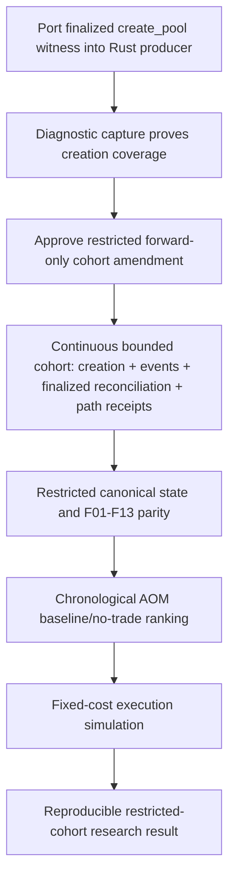

# Critical Path to the First Research Result

## Work packages and acceptance

1. **Creation adapter**: port the existing finalized `create_pool` plus event
   witness into the real Rust producer. Accept only exact 1:1 witnesses with
   finalized index/path receipt; test migration, multiple creation, malformed
   event, and standalone exclusion.
2. **Diagnostic canary**: bounded, no decisions, no execution. Accept only if
   every observed creation is independently reconciled and every path receipt
   is durable; otherwise declare source coverage inadequate.
3. **Restricted cohort approval**: approve the amendment before boundary.
   Define duration/output/RPC caps and invalidation conditions.
4. **One vertical slice**: convert receipt stream to canonical state, reproduce
   only the public analogue feature set, and produce one stable no-trade
   baseline decision. Require deterministic replay and no post-decision reads.
5. **Simulation**: apply predeclared entry/exit/cost assumptions to that
   untouched restricted cohort. Report incompleteness/no-fill/open-position
   outcomes, not only returns.

## Stop building now

No full-universe replay, new wallet fingerprint work, new execution strategy,
or feature expansion should begin before package 2 succeeds. The single
highest-leverage task is package 1: Rust integration of the existing finalized
creation witness into the same producer that already performs reconciliation
and path receipts.
