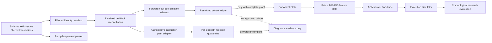

# EdgeSniffer System Architecture Map

## Scope and status

Reviewed against the VPS source tree `/root/bot/EdgeSniffer`, installed
systemd units, and the audit repository at commit `6973c95`.  “Built” does not
mean deployed; “deployed” does not mean active; “active” does not imply a
scientifically admissible data product.

## Component inventory

| Layer | Actual entry/source | Status | Contract / failure behavior |
|---|---|---|---|
| Filtered ingestion | `rust-sidecar/src/bin/kefi_finalized_rpc_reconciliation_canary_v1.rs::req` | built; prior bounded live proof | Persists filtered Pump/PumpSwap identities before decoding. Stream error sets a gap and fails closed. |
| Identity journal/reconciliation | `rust-exact-ledger/src/filtered_identity_manifest_v1.rs`; `finalized_rpc_dispatcher_v1.rs` | integrated source; live-proven for one slot | Exact signature/index comparison with finalized `getBlock`; rejects missing/extra/duplicate/version/fork evidence. |
| PumpSwap events | `rust-sidecar/src/kefi_pumpswap_semantics_v1.rs::decode_events` | integrated | Parses event logs; parser result alone is not ordering proof. |
| Path authority | `rust-exact-ledger/src/pump_instruction_path_decoder_v1.rs`; canary `finalized_input`, `path_receipts` | source-integrated, release-built, not live-tested | Full finalized message/meta establishes slot/index/outer/inner/stack tuple. Errors become path quarantine. |
| Pool identity | `kefi_pumpswap_semantics_v1.rs::resolve_pool_identity_batch` | existing; used by legacy observer/canary | RPC account layout verification; identity failures fail closed for that pool. |
| Creation witness | `scripts/pumpSwapInitDecoderV1.py::validate_finalized_init` | tested Python utility, not Rust-producer integrated | Requires `create_pool` plus matching `CreatePoolEvent`; current supported scope is canonical Pump migrations. |
| Universe/cohort proofs | `pool_universe_bootstrap_v1.rs`, `forward_new_pool_cohort_v1.rs` | offline-tested contracts | Full-universe proof requires full finalized history. Forward contract is explicitly restricted and currently has no live producer. |
| Canonical state | `rust-exact-ledger/src/canonical_state_v1.rs` | unit-tested library | Rejects sequence gaps, duplicate events and unresolved causal order; admission requires universe proof. |
| kEFi choice observer | `rust-sidecar/src/bin/kefi_teacher_independent_pool_state_feed_v1.rs` | legacy experimental lane; not Canonical-State consumer | Independent Yellowstone subscription and state engine; cannot be treated as the new canonical pipeline. |
| AOM-V0 replay/simulator | audit artifacts `AOM_V0_*`, `sanitized-code/aom-v0/` | offline framework only | Input admission is blocked without independent coverage/order/state/universe proofs. |
| Execution | `rust-sidecar`, 2CQ services | separate production/research surface | Not connected to AOM or Canonical State; must remain separate from research validation. |

## Runtime inventory relevant to this review

* `edgesniffer-kefi-full-meta-capture-first-v8.service`: inactive; V8 pause
  marker remains in place.
* `edgesniffer-kefi-canonical-finalized-rpc-canary-v1.service`: inactive;
  source is more recent than the installed prior canary binary.
* Legacy kEFi V5/V7 and holdout units include inactive and failed states.
* Separate 2CQ/dashboard/AllenHark services remain active; one dust-calibration
  unit was observed in systemd auto-restart state. They are not part of the
  Canonical/AOM dependency graph and create operational-isolation risk.
